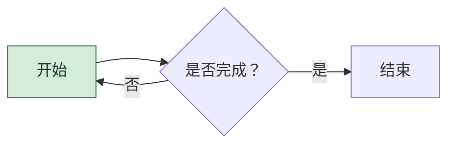
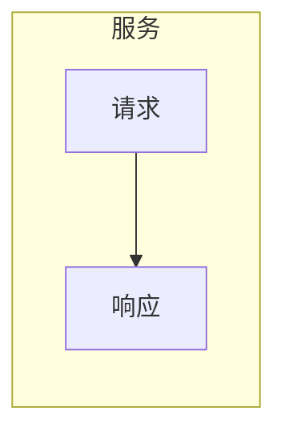
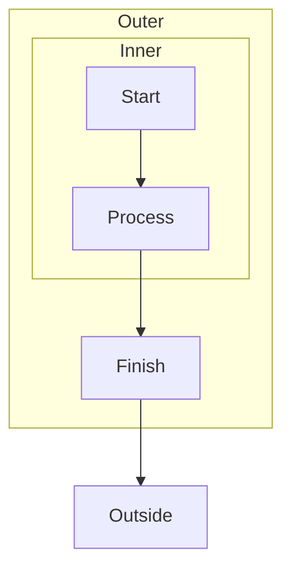
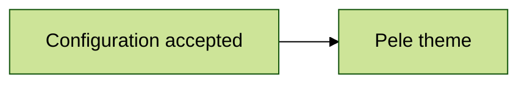
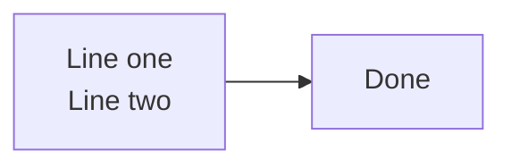
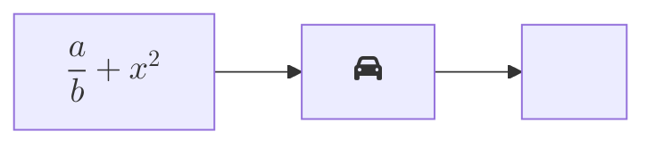
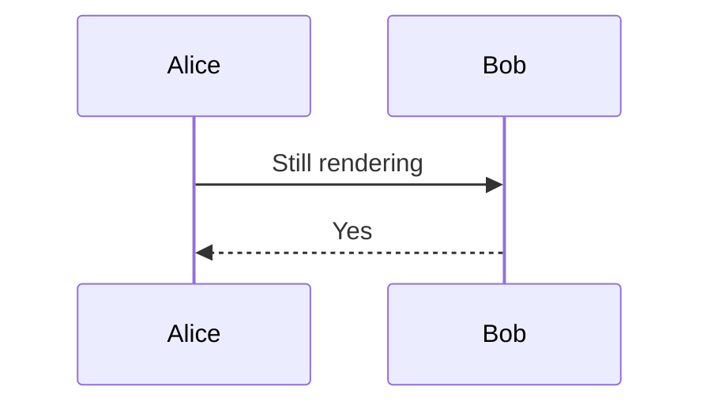

# Pele and Mermaid compatibility

Use embedded mode to check this file offline. Expected: all valid diagrams
use Pele, including math, icons, configuration and nested subgraphs. The malformed diagram shows its source
and Pele's error without loading Mermaid, and the final diagram still renders. Repeat in light/dark mode
and with Native Mermaid selected to compare layouts.

## Chinese labels and custom styles (Pele)



## Flat subgraph (Pele)



## Nested subgraphs (Pele)



## Explicit configuration (Pele, using its own theme)



## HTML label (Pele)



## Math and icons (Pele)



Unknown icons are omitted, as in the Playground.

## Image (Pele)

```mermaid
flowchart LR
    A@{ img: "https://pele.run/favicon.ico", label: "Pele" }
```

This remote image requires a connection, even when libraries are embedded.

## Malformed input (Pele error, no fallback)

```mermaid
flowchart LR
    A[Unclosed
```

## Rendering continues after an error (Pele)


